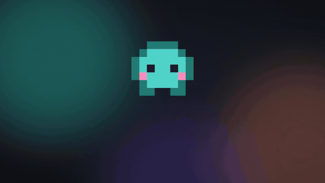
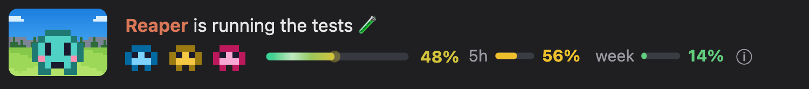

# pixel-pet

A tiny animated pixel pet that lives above your Claude Code prompt, in a little pixel world that follows your day. It naps when things are quiet, tells you what Claude is doing without becoming noise, cheers when your tests pass, waves when Claude needs you, and hatches little helpers for subagents, with a live context meter beside it.



[▶ Watch the 50-second tour with sound](https://github.com/lakmadev/claude-mods/blob/main/docs/promo/pixel-pet-promo-voiceover.mp4) · [What's new in 0.3](https://github.com/lakmadev/claude-mods/blob/main/docs/promo/pixel-pet-whats-new.mp4)



## What it does

### It's alive

- **Sleeps and wakes.** A new session finds it fast asleep: eyes closed, breathing slowly, z's drifting up and a snore bubble that swells and pops. Your first keystroke wakes it slowly (blinks, a yawn, a little stretch). After a quiet minute it nods off again.
- **Watches you type.** Its eyes follow your caret as if reading along. A backspace makes it wince, deleting a big chunk makes it gasp, a huge paste gets a "whoa", and please or thanks makes it blush.
- **Click it to pet it.** A heart pops and it blushes.
- **Lives in a little world** that changes through your day: a meadow in the morning, the desert in the afternoon, a savanna sunset in the evening, the city skyline at night and the moon after midnight. While Claude works the scenery scrolls past in layers (far mountains slow, near hills fast), so it looks like it's running through it. The scenes are original pixel art drawn in code.
- **Dresses for the date.** A pumpkin hat the week before Halloween, a Santa hat over Christmas, and a party hat at New Year and on its birthday.
- **Feels the context.** As the context fills past 60% it slows down; after `/compact` it stretches, "feels light again ✨".

### It's useful, quietly

- **Narrates Claude's work without becoming noise.** One line when the *kind* of work changes ("is reading auth.ts…", "is editing app.ts ✏️", "is running the tests 🧪"), not one per call: five reads in a row are one line. Deep in a long turn it settles into one quiet summary ("is deep in it · 23 steps · 4 files changed"). Its name stays put while the words after it slide.
- **Reacts to what matters, in colour.** "cheers: all 42 tests pass ✅" in green with a happy dance; "saw 3 tests fail ❌" in red with a groan (and a moment in a lava cave); "watched it ship 🚀" after a push; "saw the build break 🔨". Other errors just get a flinch.
- **Waves when Claude needs you.** On a permission prompt it jumps up waving with a "!" ("needs your OK ✋", in amber); when a long turn (30 seconds or more) is done it waves until you're back ("is done · 4 files changed · come take a look 👀"). Optional chirp: `/pet sound on`.
- **Hatches helpers for subagents.** Each subagent gets a mini pet half its size, in the agent's own colour (the `color:` in its definition) or a stable random one. Helpers slide into the meter line one by one, bob while their agent works, and wave bye when it's done.
- **Context meter** on its second line: a gradient bar (mint → amber → red) that glides to each reading, then your plan's 5-hour and weekly usage (or the dollars billed on the API, Bedrock, Vertex or Foundry). Point at ⓘ for tokens, reset times and how you're billed. When a plan limit passes 80% it says so once, calmly ("notes your 5-hour limit is at 82% · resets in 38m"), and once more at 95%.

### It's yours

- **One pet everywhere.** Its name, colour, stats and settings live in one file (`~/.claude/pixel-pet.json`) shared by every session and every window, terminal or desktop; a rename shows up everywhere within seconds. Or give each project its own pet with `/pet project on`. A new pet hatches with a random name (Mochi, Pixel, Pip, Nibbles…).
- **28 colours.** `/pet color pink`; it tries each colour on as you type the name.
- **Your background, or none.** `/pet scene off` for just the pet, `/pet scene on` for the one that follows your day, or `/pet scene jungle` (meadow, desert, city, skyline, snow, moon, savanna, lava, mountains) to keep one.
- **Share card.** `/pet card` saves a 1200×630 picture of your pet in its world, with your days together, turns, pets and green test runs, to your Downloads folder.
- **Calm, breaks, sound** (all off by default): `/pet calm on` keeps motion small (no bobbing or scrolling, lines fade instead of sliding); `/pet breaks on` suggests a stretch after two hours and sleep after midnight; `/pet sound on` chirps when it calls you.
- **Smooth everywhere.** In the terminal everything animates on the terminal's own frame clock; in the desktop app the pet, its world and the meter are SVGs with the motion built in.

## Install

Requires **Claude Code 2.1.293 or later**: mods are an early-access feature and gain events with each release. Check with `claude --version`; update with `claude update`.

```
/plugin marketplace add lakmadev/pixel-pet
/plugin install pixel-pet@pixel-pet
```

## Commands

| Command | |
| --- | --- |
| `/pet` | Its name, colour, hat, what's switched on, and your stats together |
| `/pet color <name>` | teal, red, orange, yellow, green, blue, purple, pink, white, gray, black, brown, cyan, mint, lime, sky, navy, indigo, violet, lavender, magenta, rose, peach, coral, gold, lava, ghost, midnight |
| `/pet rename <name>` | Rename it (a new pet gets a random name) |
| `/pet outfit <auto\|none\|pumpkin\|santa\|party>` | Its hat; `auto` (the default) dresses for the date |
| `/pet scene on\|off` | Its background: `on` (the default) changes through the day, `off` is just the pet |
| `/pet scene <meadow\|desert\|jungle\|city\|skyline\|snow\|moon\|savanna\|lava\|mountains>` | Keep one background all day |
| `/pet card` | Save a picture of it to share |
| `/pet project on\|off` | Its own name and colour in each project, so windows tell apart; `rename` and `color` then change the current project only |
| `/pet calm on\|off` | Small motion: it stays still and blinks, and lines fade instead of sliding |
| `/pet breaks on\|off` | A stretch-break nudge after two hours without a pause, and one after midnight to go to sleep |
| `/pet sound on\|off` | A soft chirp when it calls you |
| `/pet hide` / `/pet show` | Tuck it away or bring it back |

Settings (`/config`): `name` (empty for a random one) and `color`, used when a pet first hatches.

## What it reads

Hook events (tool calls, prompts, turns, subagent starts) and the usage figures Claude Code reports, plus a custom agent's definition file for its colour. It reads the `CLAUDE_CODE_USE_BEDROCK` / `_VERTEX` / `_FOUNDRY` switches to name who bills you, never an API key. It runs `date +%z` once per session to learn your time zone, so hats and late-night nudges follow your clock. Nothing leaves your machine; its name, colour, settings and counts are kept in `~/.claude/pixel-pet.json` (shared by every session) and in Claude Code's plugin store. `/pet card` writes one SVG file to your Downloads folder (or home folder).

Part of [lakmadev/claude-mods](https://github.com/lakmadev/claude-mods), a pack of eleven Claude Code mods. MIT licensed.
