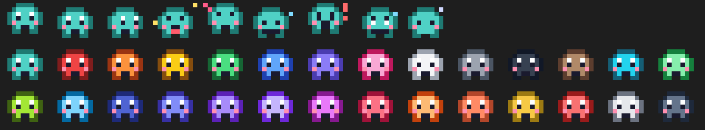

# pixel-pet

A tiny animated pixel pet that lives above your Claude Code prompt. It sleeps when things are quiet, narrates what Claude is doing, watches you type, hatches little helpers for subagents, and shows a live context meter beside it.




## What it does

- **Sleeps and wakes.** A new session finds it fast asleep: eyes closed, breathing slowly, z's drifting up and a snore bubble that swells and pops. Your first keystroke or message wakes it slowly (blinks, a yawn, a little stretch), then it carries on. After a quiet minute it nods off again through a few heavy-lidded, yawning seconds.
- **Narrates Claude's work, without becoming noise.** It says what's happening when the *kind* of work changes ("is reading auth.ts…", "is editing app.ts ✏️", "is running the tests 🧪", "is committing the work ✍️"), not on every call: five reads in a row are one line. Once a turn runs long it settles into one quiet summary ("is deep in it · 23 steps · 4 files changed"), refreshed every ten seconds or so. The pet's name stays put while the words after it slide up (desktop) or fade through (terminal).
- **Reacts to outcomes.** What matters breaks through at once, in colour: a happy dance and "cheers: all 42 tests pass ✅" in green, a wince and "saw 3 tests fail ❌" in red, "watched it ship 🚀" after a push, "saw the build break 🔨". Other errors just get a flinch.
- **Calls you when it needs you.** When Claude asks for permission, it jumps up waving with a "!" ("needs your OK ✋", in amber). When a long turn (30 seconds or more) finishes, it waves until you're back ("is done · 4 files changed · come take a look 👀"). Your next key answers it. `/pet sound on` adds a soft chirp.
- **Hatches helpers for subagents.** Each subagent Claude starts gets a mini pet half its size, in the agent's own colour (the `color:` in its definition) or a stable random one. Helpers line up on the meter line, left of the context bar, newest first. A new one opens its slot, smoothly pushing the rest of the line right, then springs in. Several started together arrive one by one. It bobs while its agent works; when the agent is done it waves bye, floats up and fades, and its slot closes.
- **Watches you type.** Its eyes follow your caret across the line as if reading along ("is reading your code…" when it looks like code). A backspace makes it wince, deleting a big chunk makes it gasp with a "!", a huge paste gets a "whoa", and please or thanks makes it blush.
- **Click it to pet it.** A heart pops where you click and it blushes.
- **Lives in a little world.** It stands in a small pixel scene that changes through your day: a meadow in the morning, the desert in the afternoon, a savanna sunset in the evening, the city skyline at night and the moon after midnight (and a lava cave for a moment when tests fail). While Claude works the scenery scrolls past in layers (far mountains slow, near hills fast), so it looks like it's running through it. `/pet scene off` turns the background off, `/pet scene on` brings it back, and `/pet scene jungle` (or meadow, desert, city, skyline, snow, moon, savanna, lava, mountains) keeps one all day. The scenes are original pixel art drawn in code.
- **One pet everywhere.** Its name, colour, stats and settings live in one file (`~/.claude/pixel-pet.json`) that every session shares, so it's the same pet in every window, in the terminal and the desktop app. A rename in one session shows up in the others within seconds. (Want a different pet per project instead? `/pet project on`.) A new pet hatches with a random name (Mochi, Pixel, Pip, Nibbles…).
- **Dresses for the date.** A pumpkin hat the week before Halloween, a Santa hat over Christmas, and a party hat at New Year and on its birthday (the day it hatched, from its first year on). `/pet outfit` picks one by hand.
- **Feels the context.** As the context fills past 60% it slows down, bobbing at half speed when it's nearly full. After `/compact` it stretches: "feels light again ✨". When your plan's 5-hour or weekly limit passes 80%, it mentions it once, calmly ("notes your 5-hour limit is at 82% · resets in 38m"), and once more at 95%.
- **Shareable card.** `/pet card` saves a 1200×630 picture of your pet in its world, with how long you've been together, turns, pets, and helpers or green test runs, to your Downloads folder.
- **Yours to tune** (all off by default): its own name and colour per project, so several windows tell apart (`/pet project on`); calm mode for small motion (`/pet calm on`); a nudge to take a break after two hours, and to sleep after midnight (`/pet breaks on`); a chirp when it calls you (`/pet sound on`).
- **Context meter** on its second line: a gradient bar (mint → amber → red) that glides to each reading and shimmers while Claude works. After it come your Claude plan's 5-hour and weekly usage as small pills, with a window's reset time once it passes 70%. On the API or Bedrock/Vertex/Foundry it shows the dollars actually billed instead. Point at the meter (ⓘ) for the details: context tokens, when each window resets, and how you're billed.
- **28 colours.** `/pet color pink` changes it. As you type the name it tries each colour on, and the names show up as suggestions.
- **Smooth everywhere.** In the terminal the pet, its helpers, the line and the meter animate on the terminal's own frame clock. In the desktop app they're transparent SVGs with the motion built in, gliding between pixels. Moods and colours fade into each other instead of popping.

## Install

Requires **Claude Code 2.1.293 or later**: mods are an early-access feature and gain events with each release. Check with `claude --version`; update with `claude update`.

```
/plugin marketplace add lakmadev/pixel-pet
/plugin install pixel-pet@pixel-pet
```

## Commands

| Command | |
| --- | --- |
| `/pet` | Its name, colour, hat, what's switched on, and your stats together |
| `/pet color <name>` | teal, red, orange, yellow, green, blue, purple, pink, white, gray, black, brown, cyan, mint, lime, sky, navy, indigo, violet, lavender, magenta, rose, peach, coral, gold, lava, ghost, midnight |
| `/pet rename <name>` | Rename it (a new pet gets a random name) |
| `/pet outfit <auto\|none\|pumpkin\|santa\|party>` | Its hat; `auto` (the default) dresses for the date |
| `/pet scene on\|off` | Its background: `on` (the default) changes through the day, `off` is just the pet |
| `/pet scene <meadow\|desert\|jungle\|city\|skyline\|snow\|moon\|savanna\|lava\|mountains>` | Keep one background all day |
| `/pet card` | Save a picture of it to share |
| `/pet project on\|off` | Its own name and colour in each project, so windows tell apart; `rename` and `color` then change the current project only |
| `/pet calm on\|off` | Small motion: it stays still and blinks, and lines fade instead of sliding |
| `/pet breaks on\|off` | A stretch-break nudge after two hours without a pause, and one after midnight to go to sleep |
| `/pet sound on\|off` | A soft chirp when it calls you |
| `/pet hide` / `/pet show` | Tuck it away or bring it back |

Settings (`/config`): `name`, `color`.

## What it reads

Hook events (tool calls, prompts, turns, subagent starts) and the usage figures Claude Code reports, plus a custom agent's definition file for its colour. It reads the `CLAUDE_CODE_USE_BEDROCK` / `_VERTEX` / `_FOUNDRY` switches to name who bills you, never an API key. It runs `date +%z` once per session to learn your time zone, so hats and late-night nudges follow your clock. Nothing leaves your machine; its name, colour, settings and counts are kept in `~/.claude/pixel-pet.json` (shared by every session) and in Claude Code's plugin store. `/pet card` writes one SVG file to your Downloads folder (or home folder).

Part of [lakmadev/claude-mods](https://github.com/lakmadev/claude-mods), a pack of eleven Claude Code mods. MIT licensed.
